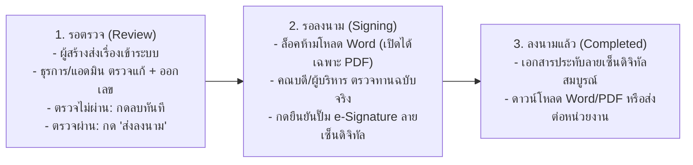

# [MANDATORY READ FIRST] FLAS-CPRU ERP: UNIVERSAL NO-CODE DOCUMENT & ENTERPRISE ARCHITECTURE

> **สำหรับ AI Assistants (Antigravity, Cursor, Copilot, ChatGPT, Claude, Codex) และทีมนักพัฒนาทุกคน:**
> **โปรดอ่านเอกสารนี้ก่อนเริ่มเขียนโค้ดหรือปรับปรุงระบบทุกครั้ง เพื่อรักษาแนวคิดทางสถาปัตยกรรม (Architecture & Design Philosophy) ให้เป็นมาตรฐานเดียวกัน 100%**

---

## 0. กฎเหล็กสูงสุด: ห้ามใช้อิโมจิ (Emoji) ทุกชนิด 100% ทั่วทั้งระบบ (Strict Zero-Emoji Policy)

- **ห้ามใช้อิโมจิทุกชนิด 100%** ทั้งในส่วนติดต่อผู้ใช้ (UI), ข้อความปุ่ม, หัวข้อเมนู, แถบสถานะ, ป้ายกำกับ, และโค้ดทั้งหมด
- ทุกไอคอนให้ใช้ **Lucide React SVG Icons** หรือฟอนต์ไอคอนมาตรฐานที่มีความคมชัด เป็นทางการ และมีความเป็นมืออาชีพเท่านั้น
- การใช้ภาษาต้องเป็นภาษาทางการ เรียบหรู สะอาดตา และได้มาตรฐานหนังสือราชการ

---

## 1. วิสัยทัศน์และสถาปัตยกรรมแบบฟอร์มเฉพาะประเภทและ Live Preview (Category-Specific Forms & Live Preview)

1. **แบบฟอร์มเฉพาะประเภท พร้อม Live Preview จากแม่แบบคงที่ (Category-Specific Structured Form with Fixed Template Live Preview)**:
   - แต่ละประเภทเอกสารมีชุดช่องกรอกเฉพาะของตนเองอย่างชัดเจน **ห้ามนำทุกฟิลด์มารวมกันในแบบฟอร์มเดียว**
   - **แยกหมวดหมู่ฟิลด์อย่างเคร่งครัด**:
     - **ช่องจำเป็น (Required)**: แสดงและบังคับกรอกตามประเภทเอกสาร
     - **ช่องทางเลือก (Optional)**: ซ่อนไว้เป็นค่าเริ่มต้น และเปิดใช้งานด้วยปุ่มกด เช่น `[+ เพิ่มอ้างถึง]`, `[+ เพิ่มสิ่งที่ส่งมาด้วย]`, `[+ เพิ่มข้อมูลผู้ประสานงาน]`, `[+ เพิ่มผู้รับเวียน]` เมื่อผู้ใช้ลบส่วนนั้นออก ระบบจะล้างค่าทิ้งทันที และไม่เหลือหัวข้อ เส้น หรือช่องว่างตกค้างใน Preview, Word (.docx) และ PDF
     - **ช่องที่ไม่เกี่ยวข้อง (Irrelevant)**: ซ่อนทิ้งอย่างสมบูรณ์ ไม่นำมาแสดงให้สับสน
2. **ไม่เติมเนื้อหาหรือชื่อบุคคลจากตัวอย่างเป็นค่าจริงโดยอัตโนมัติ (Zero Dummy Content Prefill)**:
   - ช่องกรอกเริ่มต้นจะสะอาดและว่างเปล่า โดยใช้คำแนะนำสั้น ๆ ผ่าน `placeholder="..."` ซึ่งไม่ถูกบันทึกเป็นเนื้อหาเอกสารจริง
   - มีระบบเลือกผู้ลงนามจากสายงานที่มีสิทธิ์ (เช่น คณบดี, รองคณบดี, หัวหน้าสำนักงาน, ประธานสาขา) พร้อมตัวเลือกกำหนดเอง
3. **พื้นที่สร้างเอกสารกว้างขวาง (Spacious Split-Screen Workspace)**:
   - ใช้หน้าจอแบบ 2 คอลัมน์กว้างขวาง (Left: แบบฟอร์มเฉพาะประเภท; Right: Real-time Live Preview A4/Letter บนแม่แบบคงที่) แทน Modal ยาวที่ล้นหน้าจอ
   - ระบบเป็นผู้ควบคุมกระดาษ ขนาดฟอนต์ ตราครุฑ เส้นประ/เส้นทึบ และการแบ่งหน้าตามระเบียบงานสารบรรณ พ.ศ. ๒๕๒๖ ผู้ใช้ไม่ต้องออกแบบแม่แบบเอง
   - **รหัสท้ายเอกสาร (Footer Code)**: แสดงรหัส `CPRU-66-001` ที่มุมล่างซ้ายในแม่แบบบันทึกข้อความ และบันทึกข้อความ (ว) ตามต้นฉบับจริง พร้อมเลขหน้าที่มุมขวาล่าง
4. **สิทธิ์และการบันทึกของผู้ร่าง (Drafter Actions & Permissions)**:
   - ทุกบทบาทสามารถสร้างและร่างเอกสารได้
   - **การออกเลขหนังสือ (Document Numbering)**: หนังสือจะมีคำนำหน้าหน่วยงาน (เช่น `อว 0646.02/` หรือ `อว ๐๖๔๖.๐๒/` สำหรับบันทึกข้อความ) ไว้ตลอดเวลา โดยเลขลำดับส่วนท้ายสามารถกรอกได้ทันทีหรือเว้นว่างไว้ให้ออกในขั้นตอน "รอตรวจ"
   - ผู้ร่างไม่สามารถเลือกสถานะสิ้นสุดเองได้ โดยมีปุ่มชัดเจน 2 ปุ่ม:
     - `[บันทึกร่าง]` (`action: 'ฉบับร่าง'`) — บันทึกไว้แก้ไขต่อ
     - `[ส่งตรวจ]` (`action: 'รอตรวจ'`) — ตรวจสอบความถูกต้องและส่งเข้าสู่กระบวนการตรวจทาน
5. **การประหยัดค่าใช้จ่าย Database สูงสุด (Zero Cloud Cost Architecture)**:
   - **ประมวลผล Word (.docx) และ PDF ที่ฝั่งผู้ใช้ (Client-Side Processing)** 100% ไม่ใช้ Server Compute / Cloud Functions
   - **ระบบ Local Caching (`localStorage`)**: แคชข้อมูลและประวัติในเครื่องผู้ใช้ ลดจำนวน Firestore Reads เหลือไม่ถึง 5% ภายใต้โควต้าฟรีตลอดชีพ (Firebase Spark Free Tier 50k reads / 20k writes ต่อวัน)

---

## 2. ตารางข้อกำหนดฟิลด์ทั้ง 5 ประเภทมาตรฐาน (Category Field Matrix)

| ประเภทเอกสาร | ช่องจำเป็น (Required) | ช่องทางเลือก (Optional - ซ่อน/เปิดด้วยปุ่ม) | ช่องที่ไม่เกี่ยวข้อง (Irrelevant - ซ่อนทิ้ง) |
| :--- | :--- | :--- | :--- |
| **บันทึกข้อความ (`memo`)** | วันที่, ส่วนราชการ (`from`), เรื่อง, เรียน, เนื้อหา (`bodyText`), ผู้ลงนาม, รูปแบบตัวเลข | `[+ เพิ่มอ้างถึง]`, `[+ เพิ่มสิ่งที่ส่งมาด้วย]`, `[+ เพิ่มข้อมูลผู้ประสานงาน]` | ที่อยู่หน่วยงาน (`officeAddress`), รายชื่อผู้รับเวียน (`recipients`) |
| **บันทึกข้อความ (ว) (`memo_circular`)** | วันที่, ส่วนราชการ (`from`), เรื่อง, เรียน, เนื้อหา (`bodyText`), ผู้ลงนาม, รูปแบบตัวเลข | `[+ เพิ่มผู้รับเวียน]`, `[+ เพิ่มอ้างถึง]`, `[+ เพิ่มสิ่งที่ส่งมาด้วย]`, `[+ เพิ่มข้อมูลผู้ประสานงาน]` | ที่อยู่หน่วยงาน (`officeAddress`) |
| **หนังสือภายนอก (`external`)** | วันที่, ที่ตั้งส่วนราชการ (`officeAddress`), เรื่อง, เรียน, เนื้อหา (`bodyText`), ผู้ลงนาม, รูปแบบตัวเลข | `[+ เพิ่มอ้างถึง]`, `[+ เพิ่มสิ่งที่ส่งมาด้วย]`, `[+ เพิ่มข้อมูลผู้ประสานงาน]` | รายชื่อผู้รับเวียน (`recipients`) |
| **หนังสือภายนอก (ว) (`external_circular`)** | วันที่, ที่ตั้งส่วนราชการ (`officeAddress`), เรื่อง, เรียน, เนื้อหา (`bodyText`), ผู้ลงนาม, รูปแบบตัวเลข | `[+ เพิ่มผู้รับเวียน]`, `[+ เพิ่มอ้างถึง]`, `[+ เพิ่มสิ่งที่ส่งมาด้วย]`, `[+ เพิ่มข้อมูลผู้ประสานงาน]` | - |
| **คำสั่ง (`order`)** | วันที่สั่งการ, หน่วยงานผู้ออกคำสั่ง (`from`), เรื่อง, เนื้อหาคำสั่ง/เหตุผล (`bodyText`), ผู้ลงนาม, รูปแบบตัวเลข | `[+ เพิ่มรายชื่อคณะกรรมการ/หน้าที่]`, `[+ เพิ่มอ้างถึงคำสั่งเดิม]`, `[+ เพิ่มข้อมูลผู้ประสานงาน]` | เรียน (`to`), สิ่งที่ส่งมาด้วย (`attachmentsText`), ที่อยู่หน่วยงานมุมบน (`officeAddress`) |

---

## 3. โครงสร้างฐานข้อมูลและการเชื่อมโยง (Unified Firestore Schema)

### Collection: `admin_doc_registry` (สมุดทะเบียนคุมและประวัติเอกสารทุกโมดูล)
```typescript
interface AdminDocRegistryRecord {
  id: string;
  category: string;           // หมวดหมู่เอกสาร (memo, memo_circular, external, external_circular, order ฯลฯ)
  year: number;               // ปี พ.ศ. (เช่น 2569)
  sequenceNumber: number;     // เลขรันลำดับที่ (1, 2, 3, ...)
  docNumber: string;          // เลขที่ฉบับเต็ม เช่น "อว ๐๖๔๖.๐๒/๑๐๑" หรือ "ที่ ๑๖๑/๒๕๖๙"
  isNumberIssued?: boolean;   // สถานะการออกเลขทะเบียนคุม
  date: string;               // YYYY-MM-DD
  from: string;
  to: string;
  subject: string;
  action: 'ฉบับร่าง' | 'รอตรวจ' | 'รอลงนาม' | 'ลงนามแล้ว';
  remarks?: string;
  referenceDoc?: string;      // อ้างถึง (ถ้าเปิดใช้งาน)
  attachmentsList?: string[]; // สิ่งที่ส่งมาด้วย (ถ้าเปิดใช้งาน)
  bodyParagraphs?: string[];  // เนื้อหาข้อความจริงแต่ละย่อหน้า
  signatoryName?: string;     // ชื่อผู้ลงนาม
  signatoryPosition?: string; // ตำแหน่งผู้ลงนาม
  signatureUrl?: string;      // ลายเซ็นต์ e-Signature ดิจิทัลแบบโปร่งใส
  signedAt?: string;          // วันที่ประทับลายเซ็น
  signedById?: string;
  signedByName?: string;
  coordinatorInfo?: string;   // ข้อมูลผู้ประสานงาน (ถ้าเปิดใช้งาน)
  officeAddress?: string;     // ที่อยู่หน่วยงาน (สำหรับหนังสือภายนอก)
  recipients?: string[];      // ผู้รับเวียน (สำหรับหนังสือเวียน)
  digitType?: 'thai' | 'arabic';
  paperSize?: 'a4' | 'letter';
  headerLineStyle?: 'dot_leader' | 'solid' | 'none';
  lineVisibility?: { govOrg?: boolean; docDate?: boolean; subject?: boolean; docNumber?: boolean };
  filePath?: string;          // ลิงก์ไฟล์สแกนฉบับจริง
  fileUrl?: string;
  fileName?: string;
  createdById?: string;
  createdByName?: string;
  createdAt: string;
  updatedAt?: string;
  revision?: number;
}
```

---

## 4. สถาปัตยกรรมบทบาทและสิทธิ์แบบหลายยศ (Discord-like Multi-Role & Permissions)

### 1. รายชื่อ 12 บทบาทมาตรฐานทั้ง 5 โมดูลของคณะ:
- **ฝ่ายบริหาร & อนุมัติ**: `แอดมิน`, `คณบดี`, `รองคณบดี`, `ผู้บริหาร`, `ประธานสาขา`
- **เจ้าหน้าที่ประจำฝ่าย (5 โมดูล)**: `ธุรการ` (Admin), `การเงิน` (Finance), `พัสดุ` (Procurement), `แผนงาน` (Projects & Plan), `บุคคล` (HR)
- **ผู้ใช้งานทั่วไป**: `อาจารย์`, `เจ้าหน้าที่`

### 2. หลักการทำงานของระบบสิทธิ์:
1. **การติดป้ายยศหลายชั้น (Multi-Role Stack)**: ในหน้า `/settings/users` แอดมินสามารถกำหนดบทบาทให้ผู้ใช้ได้หลายยศพร้อมกัน
2. **การรวมสิทธิ์สูงสุด (Cumulative Permissions)**: สิทธิ์ของผู้ใช้จะนับรวมจากทุกยศที่ถือครอง ณ ปัจจุบันโดยอัตโนมัติ
3. **การตรึงประวัติเอกสารย้อนหลัง (Document Snapshot History)**: เมื่อเอกสารได้รับการอนุมัติหรือลงนาม ระบบจะ Snapshot ชื่อ-ตำแหน่ง-ลายเซ็นต์ฝังลงใน Record ทันที

---

## 5. ระบบสายอนุมัติ 3 สถานะกระชับ (Streamlined 3-Step Approval Pipeline)



### การควบคุมความปลอดภัยในแต่ละขั้นตอน:
- **1. ฉบับร่าง (Draft) & รอตรวจ (Pending Review)**: ผู้สร้างสามารถแก้ไขได้ ธุรการและแอดมินตรวจทานความถูกต้องและออกเลขทะเบียน หากไม่ผ่าน **ธุรการสามารถกดลบทิ้งได้ทันที** หากถูกต้องให้กด **"ส่งลงนาม"**
- **2. รอลงนาม (Pending Signing)**: เฉพาะผู้มีอำนาจลงนาม (`คณบดี`, `รองคณบดี`, `ผู้บริหาร`, `แอดมิน`) เท่านั้นที่จะเห็นปุ่ม **"ลงนาม (e-Signature)"** โดยในขั้นตอนนี้ **ระบบจะล็อคการดาวน์โหลด Word (.docx) ให้ดู/พิมพ์ได้เฉพาะ PDF เท่านั้น** เพื่อป้องกันการแก้ไขเอกสารก่อนลงนาม
- **3. ลงนามแล้ว (Signed)**: เมื่อกดยืนยันลงนาม ระบบจะนำรูปลายเซ็นโปร่งใส (Transparent e-Signature PNG) ของผู้ลงนามมาประทับลงบนเอกสาร A4 ทันที พร้อมบันทึก Snapshot วันที่และผู้ลงนาม

---

## 6. กฎเกณฑ์มาตรฐานหนังสือราชการ (Thai Government Correspondence Standards)

ระบบนี้ยึดถือตาม **ระเบียบสำนักนายกรัฐมนตรีว่าด้วยงานสารบรรณ พ.ศ. ๒๕๒๖** และคู่มือการพิมพ์หนังสือราชการอย่างเคร่งครัด:

1. **ฟอนต์มาตรฐาน**:
   - `TH SarabunPSK` (หรือ `Sarabun`) ขนาด **16pt** สำหรับเนื้อหาทั่วไป
   - ขนาด **20pt หนา** สำหรับหัวข้อ/ป้ายกำกับ
   - ขนาด **29pt หนา** สำหรับคำว่า "บันทึกข้อความ"
2. **ระยะขอบกระดาษ (Margins)**:
   - ขอบซ้าย: **3.0 ซม. (30 มม.)**
   - ขอบขวา: **2.0 ซม. (20 มม.)**
   - ขอบบน: **2.5 ซม. (25 มม.)**
   - ขอบล่าง: **2.0 ซม. (20 มม.)**
3. **ระยะเคาะและการจัดย่อหน้า**:
   - ย่อหน้าเริ่มต้นเยื้อง: **2.5 ซม.** (หรือประมาณ 8 เคาะ)
   - การเว้นวรรคระหว่างชื่อและนามสกุล: **2 เคาะ (2 Spaces)**
   - การจัดแนวเนื้อหา: **Thai Distributed / Justify** (กระจายชิดขอบซ้าย-ขวาเท่ากัน)
4. **ตราครุฑ (Garuda Emblem)**:
   - บันทึกข้อความ: ตราครุฑสูง **1.5 ซม.** วางชิดซ้ายบน
   - หนังสือภายนอก และ คำสั่ง: ตราครุฑสูง **3.0 ซม.** วางกึ่งกลางบน

---

## 7. แผนที่ไฟล์และโครงสร้างโค้ดหลัก (Key File Map)

| ไฟล์ / โฟลเดอร์ | หน้าที่และการทำงาน |
| :--- | :--- |
| [components/CategoryDocEditor.tsx](file:///d:/Faculty%20of%20Liberal%20Arts%20and%20Sciences/components/CategoryDocEditor.tsx) | **Category-Specific Editor & Live Preview**: หน้าสร้าง/แก้ไขเอกสารแบบแยกช่องตามประเภท พร้อม Live Preview แบบ A4 Real-time |
| [components/AdminRegistryTable.tsx](file:///d:/Faculty%20of%20Liberal%20Arts%20and%20Sciences/components/AdminRegistryTable.tsx) | สมุดทะเบียนคุม ออกเลข ค้นหา กรองสถานะ ดาวน์โหลด Word/PDF และปุ่มเข้าสู่ตัวสร้างเอกสาร |
| [lib/adminDocument.ts](file:///d:/Faculty%20of%20Liberal%20Arts%20and%20Sciences/lib/adminDocument.ts) | เครื่องยนต์สร้าง HTML Preview, คำนวณวันที่ราชการ, แปลงเลขไทย/อารบิก, และส่งออกไฟล์ Word (.docx) & PDF |
| [lib/adminCategoryService.ts](file:///d:/Faculty%20of%20Liberal%20Arts%20and%20Sciences/lib/adminCategoryService.ts) | เซอร์วิสจัดการแม่แบบและประเภทเอกสาร เชื่อมต่อ Firestore + แคช LocalStorage |
| [lib/workflowPermissionService.ts](file:///d:/Faculty%20of%20Liberal%20Arts%20and%20Sciences/lib/workflowPermissionService.ts) | ระบบตรวจสอบสิทธิ์แบบละเอียดตามสายงานและบทบาท |
| [app/admin/doc/[category]/page.tsx](file:///d:/Faculty%20of%20Liberal%20Arts%20and%20Sciences/app/admin/doc/[category]/page.tsx) | ตัวเรนเดอร์หน้าสมุดทะเบียนสำหรับประเภทเอกสารไดนามิก |

---

## 8. แนวทางสำหรับ AI / Developer ในการพัฒนาต่อยอดในอนาคต

1. **ห้ามใช้อิโมจิทุกชนิด 100% ใน UI และข้อความระบบ**:
   - ใช้ Lucide SVG Icons หรือไอคอนทางการเท่านั้น
2. **รักษาความเข้ากันได้ 1:1 ของ Preview, Word (.docx) และ PDF เสมอ**:
   - ทุกมุมมองต้องใช้ตรรกะ ข้อมูล และข้อกำหนดแม่แบบชุดเดียวกัน
3. **ความปลอดภัยในการออกเลขและสายอนุมัติ**:
   - ผู้ร่างไม่สามารถกรอก/แก้เลขหนังสือเองได้ เจ้าหน้าที่จะออกเลขผ่าน Transaction ในขั้นรอตรวจ
4. **ตรวจสอบความถูกต้องก่อน Deploy ทุกครั้ง**:
   - รัน `node tests/test-runner.cjs`
   - รัน `npx tsc --noEmit` เพื่อตรวจประเภทข้อมูล
   - รัน `npm run build` เพื่อตรวจ Static Export (ต้องผ่านครบทุกหน้าเสมอ)
